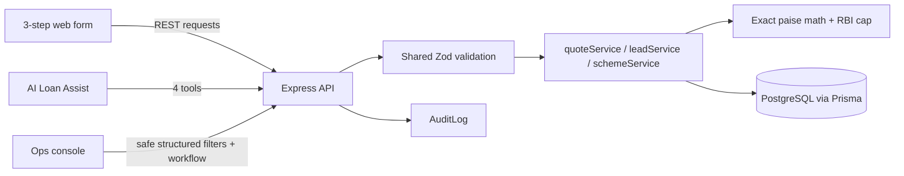
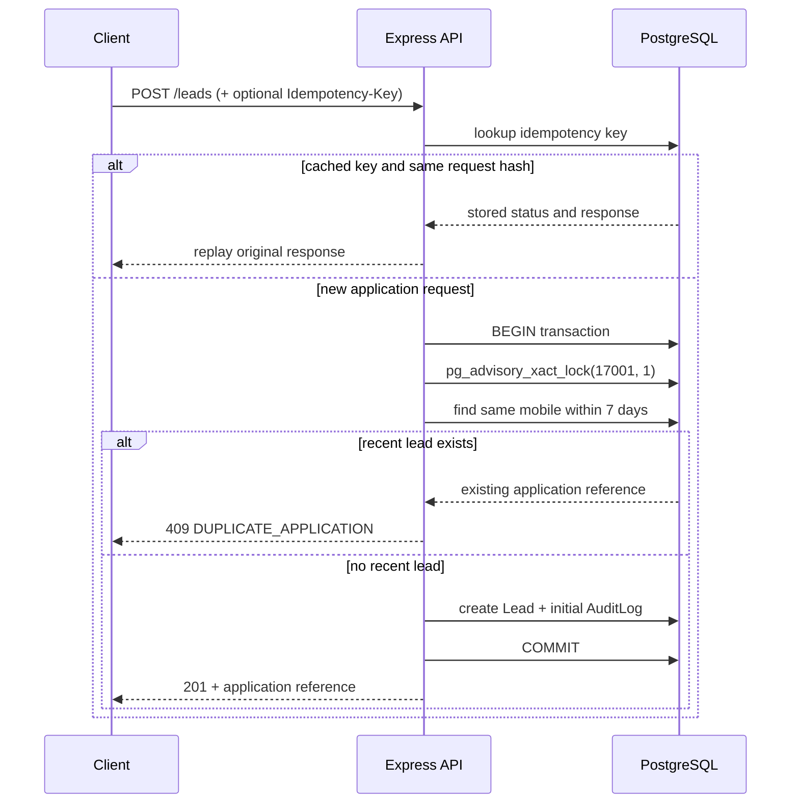

# Architecture

## Same truth, two paths

The borrower form and the AI assistant converge on the same validation and domain service functions. The browser never supplies authoritative quote values; it requests them from the API. Agent tool arguments are parsed through the same Zod schemas before reaching those services.



`get_loan_schemes`, `calculate_quote`, `check_existing_application`, and `submit_application` use the application service layer. Confirmation state is held per chat session; a `submit_application` call without both explicit confirmation and a matching pending summary returns a confirmation-required result and does not insert a lead. The admin language filter is parsed to a Zod-checked object and translated to Prisma `where` conditions; user text never becomes SQL.

## Integer paise math and RBI LTV cap

Money is stored as integer paise in `BigInt` columns. Percentage and weight inputs use Prisma `Decimal`; no money calculation relies on floating-point rupees. For a 24K rate `R` paise/gram, net weight `W`, karat `K`, and plan LTV percentage `L`, the service calculates:

```text
pure gold grams = W × K / 24
gold value paise = floor(W × K × R / 24)
effective LTV = min(L / 100, 75 / 100)
eligible loan paise = floor(gold value paise × effective LTV)
display rupees = floor(paise / 100)
```

The implementation keeps numerator/denominator arithmetic intact until flooring. The plan's configured LTV is always capped at 75% in the service, even if a database row has a larger value. An appraisal quote is an estimate; the final decision remains subject to physical appraisal at the branch.

## Duplicate and retry concurrency

The idempotency middleware hashes the request body and stores the original status and response by idempotency key. Repeating a key with the same request replays the original response; reusing it with a different body is rejected. Concurrent requests with distinct/no idempotency keys still need a serialized mobile check because a read-then-create sequence alone races.



The PostgreSQL transaction-level advisory lock is held until commit/rollback, so simultaneous check-and-insert requests cannot both pass the seven-day duplicate check. The initial `SUBMITTED` audit event and lead are committed together. Status transitions validate the allowed workflow and write the new state plus its audit event transactionally.

## Runtime boundaries

- `apps/web`: React/Vite borrower flow, agent chat, and admin console. Development uses Vite's `/api` proxy; the container build uses Nginx to proxy to the API service.
- `apps/api`: Express routes, request validation, service layer, deterministic agent orchestration, and Prisma access.
- PostgreSQL: plans, leads, idempotency records, and immutable audit events.
- Optional LLM providers: Gemini, Groq, or Ollama may propose a tool call. The same validated deterministic orchestrator is the fallback when the provider is unavailable, rate limited, or unconfigured.
- CI: GitHub Actions provisions PostgreSQL, applies migrations, seeds plans/data, then runs API tests and the ten agent evaluations.
